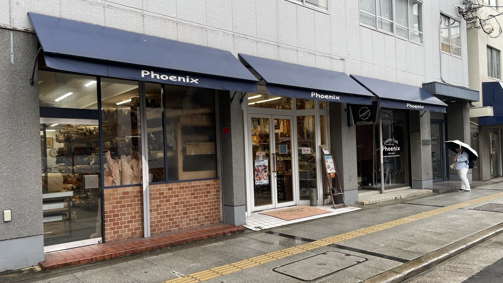
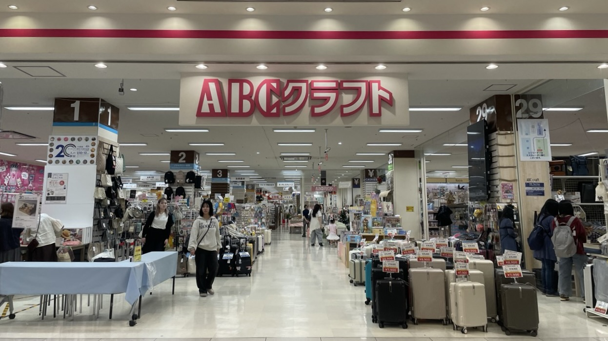

上个月写过一篇布料为主的[探店文]()，最近又发现了两家新店，简单写下。

  
**Leathercraft Phoenix**

做帆布包需要40mm的buckle，不知道中文叫什么，腰带头？几家布艺店找遍了没有这个尺寸，顶多25mm，颜色也不对。打算网上买，翻了几个网站发现中意的，网站里点点点，顺藤摸瓜发现这家有线下店，立马奔过去。

在难波附近，挺好找，店面也大，各种工具配件一应俱全，隔壁一间屋全是成卷的皮子。我去的这天下着小雨，店里头也熙熙攘攘，人还挺多。有些东西价格也是真贵，床面打磨棒，黑檀木的，卖三千多，淘宝也就十几几十块吧。冲孔的东西同理。日本这个价格系统真是，啧啧。

好在确实找到了40mm的buckle，跟想要的几乎一致。感慨买东西真要找对地方才行。都是手工，布料和皮料用的东西，尺寸、种类、风格差距是真大，完全不同世界的感觉。

店里好多试用、样品，很直观。皮子，有A4大小，也可以切。整张铺开，竖着切一长条，10cm起卖，超过10cm了可以以1cm为单位切，按ds（10cm×10cm）计价。挺灵活的。

在店里东摸西摸的时候，有人拿着几块buttero来说要削薄。店主给做记号，说大概几天能好。我站边上趁机揩油摸了几把，确实皮质真好啊，油光水亮的，应该是油多或者打过蜡的。顺便问店主哪里有buttero卖，他说日本有一家总代理，意大利厂家没有做「卸売り」，就是放开给批发渠道，所以市面上没有卖的，只能从代理店那里买。我点点头，想，跟自己查到的一样。



日本的buttero总代理叫做“サライ商事”，在东京。[官网在这](https://www.sarai-shoji.com/leather/04.html)。网站做得漂亮现代，但整个公司的思维和运营方式还卡在昭和60年代。没有网络商城，没有自助购物。想买buttero，想知道现在的库存，有什么颜色，哪个系列，多大，全要邮件或者fax去问。

第一次买的话，算是新顾客，要先填表交代个人信息，为什么要买，买了干嘛，之后会不会长期购买。完全是老式的日本公司之间做买卖的模式，像是判断能不能安全放心地卖给这个人/公司一样，但其实只是个平白增加麻烦的过场而已。

最绝的是，新客户第一次下单前，这个公司还要求客户本人必须去他们公司一趟，当面聊。官网美其名曰：当面确认客人的需求，需要怎么处理加工等等。估计是怕事后担责，想杜绝纠纷，所以事先宣读免责条文。我脑补这个公司也许之前遇到过新客户下单后反复来抱怨，公司焦头烂额的情形。一朝被蛇咬，十年怕井绳。但这也太因噎废食了。典型的日本做法。

**跑题结束。**


谷歌还给我推荐了附近另一家店，叫[革とレザークラフト用品 ニシカワレザー](https://www.nishikawaleather.com)，还没去过。看官网各种稀罕贵价皮子，鳄鱼皮蛇皮鲨鱼皮都有。一三五营业，二四要提前预约，中午还不开门。感慨皮革手工店真是生意兴隆。  

  
**[ABC CRAFT](https://www.abc-craft.co.jp/shop-abeno.html)**

一家大型手作材料中心。在阿倍野Q's Mall，地铁/JR天王寺站或者近铁阿倍野桥出来西南角。商场3楼，占地面积巨～～～大，各种材料和选择也比其他店多很多的感觉。

一进去有好多好多好多首饰的道具，在一个不起眼的地方还看到有化石标本卖？？？什么鲨鱼牙，珊瑚化石。当然我也不买。好多标了天然石，我不信（鲁豫微笑）。还有很多看着很fancy的珠子，估计不是玻璃就是合成。

又跑题了。这个规模的首饰配件，让我想起另一家很出名的店，贵和制作所。那家在梅田，也是各种小玩意儿应有尽有，就是贵。船场白生地商店的老板都说贵。

里面是毛线，布料，皮革等等不同分区，顶上吊着牌子，还挺好找。每个分区有自己的切割台，可以就近裁切。貌似会不定期半各种手工制作班，看到个做皮具的班的海报，参加费倒是不贵，三四千日元，感觉挺实在。毛线种类和色系很多，但贵。样品很多，看到个跟白石京刚做的一样的款，心想世界这么小这么巧。印度刺绣，种类和价格都介于日本纽扣和yuzawaya之间。布料，好的点是有一部分是按色系排列，好看，缺点是都贵，嗯。

皮具，终于有家卖裁切好的皮子的店了，我两眼放光。切好的摸着铬鞣多，也有植鞣，需要仔细分辨。颜色红黄蓝绿也很多。还有大块的整张皮子，感觉都是姬路的铬鞣皮了。工具类，菱斩什么的卖的比Dream要贵，当然种类和选择也更多更齐全的感觉。这家店的皮革区域是去过的手艺材料中心里最大的，这点好评。

再说整个店的标价体系，就，挺可笑。价签从上到下三个价格：本店销售价；折扣价；VIP价。VIP价会便宜不少，但也有东西是三个价格都一样。结账时扫到一眼说折扣价是9折，VIP是7折。估计也是要办什么卡有什么年费吧，甚至会要求年消费？我没兴趣。

在里面看到其他店没有的尼龙材质的织带，蛮厚实的，跟我登山裤用的腰带一样。打算确认了宽度去买，替换掉现在短裤上的带子。逛多了感想是，好多东西其实都能找到，就是咱不知道叫啥，怎么去搜，大部分店也就经营那些到处都卖的大路货，所以跟大海捞针似的，老费劲了。

不过逛这么多店，我的观点还是：不要买现在用不到、不需要的东西。没有明确要做的东西的时候看到不错的也不买，哪怕缺的时候再去找，也不要“先买了再说”。为了用掉什么东西而硬做的话，做起来不开心，做出来也不一定会用。白占地方。

虽然我也没有完全做到，哈哈。